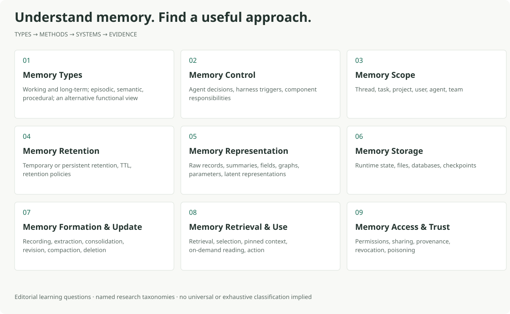

# Awesome Harness Memory

> Understand how agents remember, update, and use information. Find useful methods, systems, papers, and evaluations.

[English](README.md) · [简体中文](README.zh-CN.md) · **[Explore the interactive guide (中文) →](https://dongshuyan.github.io/awesome-harness-memory/)** · **[Research × engineering report (中文) →](https://dongshuyan.github.io/awesome-harness-memory/report/index.html)**

For researchers, engineers, and curious learners: start with the memory landscape, understand the available approaches, then follow their features, highlights, limitations, and original sources.

Memory is the only core topic here. Research perspectives and named engineering objects are organized side by side: named agents, harnesses, frameworks, standalone memory systems or services, and product memory. Research explains how memory can be observed and divided. Engineering entries show how a named system stores, updates, and uses memory. Their terms are not assumed to be equivalent.

Here, *harness* means the runtime and control boundary around an agent. The guide also includes standalone memory layers, managed services, personal assistants, human memory research, and literary analogies.

## Understand the landscape

| Question | What to look for |
| --- | --- |
| [Memory Types](docs/landscape.zh-CN.md#types) | Working and long-term; episodic, semantic, procedural; an alternative functional view |
| [Memory Control](docs/landscape.zh-CN.md#control) | Agent decisions, harness triggers, component responsibilities |
| [Memory Scope](docs/landscape.zh-CN.md#scope) | Thread, task, project, user, agent, team |
| [Memory Retention](docs/landscape.zh-CN.md#retention) | Temporary or persistent retention, TTL, retention policies |
| [Memory Representation](docs/landscape.zh-CN.md#representation) | Raw records, summaries, fields, graphs, parameters, latent representations |
| [Memory Storage](docs/landscape.zh-CN.md#storage) | Runtime state, files, databases, checkpoints |
| [Memory Formation & Update](docs/landscape.zh-CN.md#write) | Recording, extraction, consolidation, revision, compaction, deletion |
| [Memory Retrieval & Use](docs/landscape.zh-CN.md#read) | Retrieval, selection, pinned context, on-demand reading, action |
| [Memory Access & Trust](docs/landscape.zh-CN.md#trust) | Permissions, sharing, provenance, revocation, poisoning |

These nine questions organize the learning guide. Memory Types uses a source-labelled CoALA tree, with an alternative functional taxonomy from a separate survey. Context, Workspace, and Long-term Memory have a separate terminology guide that explains overlap. Topics include Chinese explanations, English terms, uses, examples, and original sources.

The expanded guide and detailed catalogue are currently **in Chinese**; source titles and original links retain their original languages. The earlier [English reference pages](resources/systems.md) and [early bilingual concept map](explore/README.md) remain available with their narrower coverage marked.

## Research and engineering side by side

- **Research** covers perspectives on memory, such as CoALA, Forms / Functions / Dynamics, Foundation Agent Memory, Storage → Reflection → Experience, the LLM Memory tuple, and method views from papers such as Generative Agents, MemGPT, Reflexion, Voyager, and A-MEM. These perspectives ask different questions and do not form one unified taxonomy tree.
- **Engineering** covers named agents, harnesses, frameworks, standalone memory systems or services, and product memory. Each entry keeps its own name, purpose, write and read behavior, scope, and evidence boundary.
- **Research × engineering** compares each engineering entry with each Research perspective, one pair at a time. The detailed page separates source facts, engineering state, editorial analysis, reasons for difference, and design assumptions still to be verified.

## Find a useful starting point

- **[Browse systems and products](resources/systems.zh-CN.md)** — Pi, Codex, Claude Code, Claude-Mem, OpenClaw, Hermes, Letta Code, LangGraph, Mem0, Hindsight, MemOS, Graphiti, Zep, and more. ChatGPT Memory is a separate personal-assistant comparison.
- **[Start from your needs](docs/needs.zh-CN.md)** — continue across sessions, remember preferences, reuse experience, track changing facts, or coordinate several agents.
- **[Read papers and methods](resources/papers.zh-CN.md)** or **[start with surveys](resources/surveys.zh-CN.md)** — distinguish research claims from current product behavior.
- **[Choose evaluations](resources/benchmarks.zh-CN.md)** — examine recall, useful actions, updates, sharing, safety, and cost. The [English evaluation guide](docs/evaluation-guide.md) explains comparison conditions.
- **[Explore human memory](resources/human.zh-CN.md)** and **[fiction and screen](resources/fiction.zh-CN.md)** — cognitive and neural evidence, alongside clearly labeled analogies.

## Explore combinations visually

The [interactive guide](https://dongshuyan.github.io/awesome-harness-memory/) provides search, filters, explanations, and views for comparing documented system properties. Open **图解探索** for the layered diagram: select several perspectives, adjust the view, and highlight one system across layers.

The diagram covers the Harness / Agent entries identified in this catalogue, not an exhaustive industry list. It includes **22 real Harness / Agent profiles**, with three historical projects clearly labeled. Select objects and perspectives, then open any cell for its definition, conditions, and source. The [static preview](assets/memory-layers.svg) shows six of these objects across three perspectives. Unknown properties stay unknown; colors are not a quality ranking. Standalone memory services, plugins, and general frameworks remain in the resource directory.

The [research × engineering report](https://dongshuyan.github.io/awesome-harness-memory/report/index.html) has two views. The **Research perspective map** shows how different research lenses observe memory. The **engineering × Research coverage matrix** shows each pair's current evidence depth. Both views show observation entries and evidence status only. They do not show rankings, performance, quality, or similarity. Open a matrix cell to read the pair-level comparison.

README links and static images work directly on GitHub. For a local preview, run `python3 -m http.server 8000 --bind 127.0.0.1` from the repository root and open `http://127.0.0.1:8000/`. For the local report page, open `http://127.0.0.1:8000/report/index.html`.

## Coverage and evidence

Sources checked through **2026-11-07 UTC**. The catalogue contains **138 resources**: 56 with documented basic information, 47 research reading entries, 32 unresolved leads, and 3 historical entries. Within that total, **49 systems** have primary sources supporting their basic functional descriptions. Inspect the [structured catalogue](catalogue.json) for entries, sources, and status.

The research × engineering report uses a separate working set of **10 Research perspectives, 54 engineering entries, and 540 pairs**, as reviewed on 2026-11-09. These counts are not part of the 138-resource catalogue and should not be added to it. Most pairs remain at catalogue level pending deeper comparison. Its evidence labels describe what was checked at that review date.

Document checks do not establish implementation completeness, reproduced performance, deployment maturity, or security certification. No system installation or benchmark execution is implied. Unresolved names and properties remain labeled; the catalogue is not exhaustive, and its counts are not market shares. Fiction illustrates design questions rather than supplying evidence about model cognition.

See the [contribution guide](CONTRIBUTING.md), [roadmap](ROADMAP.md), or [repository structure and publishing notes](docs/repository-structure.md). If the guide helps you learn or find useful work, a star helps others discover it.
