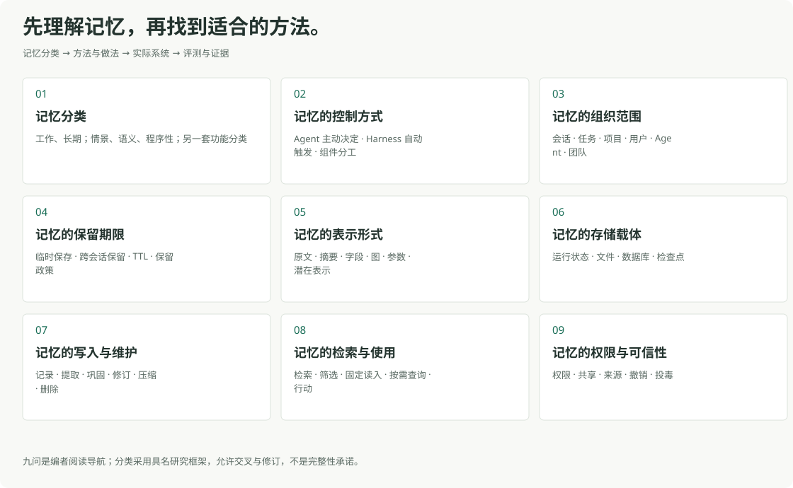
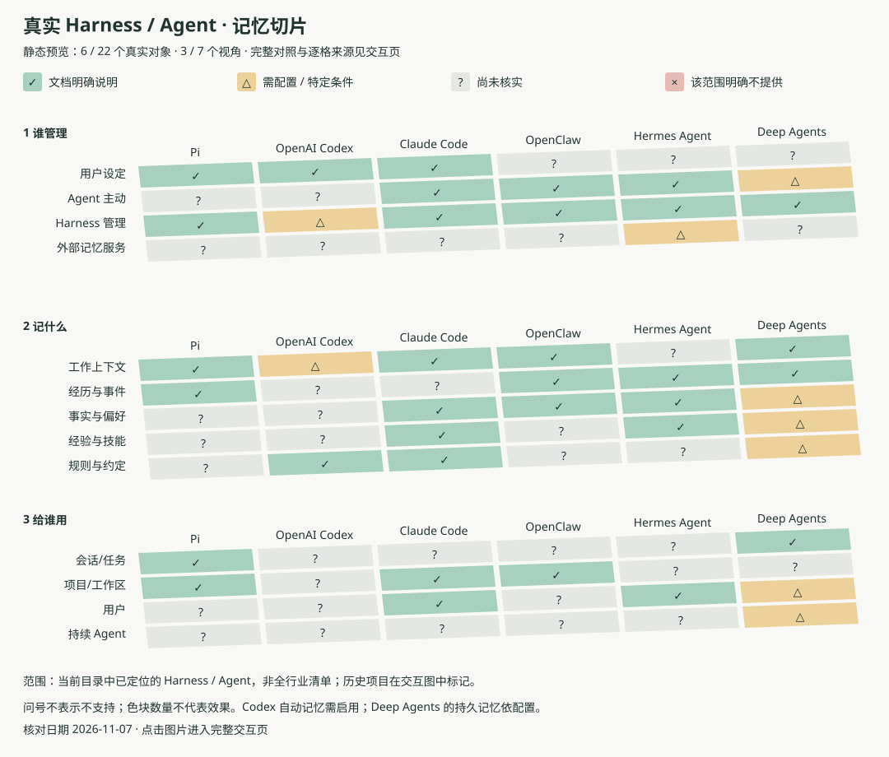

# Awesome Harness Memory

[English](README.md) · [简体中文](README.zh-CN.md) · **[打开交互导航](https://dongshuyan.github.io/awesome-harness-memory/)**

理解 Agent 如何记住、更新和使用信息，找到值得继续读的论文、方法、系统与评测。

[知识全景](docs/landscape.zh-CN.md) · [按需求找资料](docs/needs.zh-CN.md) · [系统与产品](resources/systems.zh-CN.md) · [论文与方法](resources/papers.zh-CN.md) · [评测](resources/benchmarks.zh-CN.md)

## 先建立全景

| 你想理解的问题 | 从这里开始 |
| --- | --- |
| [记忆分类](docs/landscape.zh-CN.md#types) | 工作、长期；情景、语义、程序性；另一套功能分类 |
| [记忆的控制方式](docs/landscape.zh-CN.md#control) | Agent 主动决定 · Harness 自动触发 · 组件分工 |
| [记忆的组织范围](docs/landscape.zh-CN.md#scope) | 会话 · 任务 · 项目 · 用户 · Agent · 团队 |
| [记忆的保留期限](docs/landscape.zh-CN.md#retention) | 临时保存 · 跨会话保留 · TTL · 保留政策 |
| [记忆的表示形式](docs/landscape.zh-CN.md#representation) | 原文 · 摘要 · 字段 · 图 · 参数 · 潜在表示 |
| [记忆的存储载体](docs/landscape.zh-CN.md#storage) | 运行状态 · 文件 · 数据库 · 检查点 |
| [记忆的写入与维护](docs/landscape.zh-CN.md#write) | 记录 · 提取 · 巩固 · 修订 · 压缩 · 删除 |
| [记忆的检索与使用](docs/landscape.zh-CN.md#read) | 检索 · 筛选 · 固定读入 · 按需查询 · 行动 |
| [记忆的权限与可信性](docs/landscape.zh-CN.md#trust) | 权限 · 共享 · 来源 · 撤销 · 投毒 |

九问是阅读导航。记忆分类默认采用有来源的 CoALA 分类树，也可切换另一篇综述的功能分类。Context / Workspace / Long-term 提供单独的叫法对照，允许重叠。每项有中英文术语、解释、用途、例子和来源。

## 从具体对象开始

- **[Harness、Agent、独立记忆层与服务](resources/systems.zh-CN.md)**：包括 Pi、Codex、Claude Code、Claude-Mem、OpenClaw、Hermes、Letta Code、LangGraph、Mem0、Hindsight、MemOS、Graphiti / Zep 等。另以 ChatGPT Memory 作为个人助手产品对照，和开发框架分组阅读。
- **[论文与方法](resources/papers.zh-CN.md)**、**[综述](resources/surveys.zh-CN.md)**：从研究问题进入原始工作，区分论文结论与当前实现。
- **[Benchmark 与评测工具](resources/benchmarks.zh-CN.md)**：分别看召回、实际使用、行动、更新、共享、安全和成本。
- **[人类记忆](resources/human.zh-CN.md)**：认知规律与关键脑机制；**[文学影视](resources/fiction.zh-CN.md)**：作为设定与类比阅读。

## 用图理解组合

交互图覆盖当前目录中已定位的 Harness / Agent，尚非全行业穷尽清单。已收录 **21 个真实 Harness / Agent 对象**（含 3 个标记为历史的项目），支持多选对象、多选层、跨层高亮和逐格查看来源。上图是其中 6 个对象、3 个视角的静态预览。✓ 表示文档明确说明，△ 表示需配置或特定条件，? 表示尚未核实，× 只用于来源明确排除的范围；不按色块数量排名。

七层是已核属性的选定投影，并非九个学习专题的完整能力测量。

图中不把独立记忆服务、插件或纯框架当作 Harness；这些资料继续保留在 [系统目录](resources/systems.zh-CN.md)。逐项依据及核对日期见 [图表数据](assets/harness-map.json)。

## 打开交互导航

**[进入在线知识导航](https://dongshuyan.github.io/awesome-harness-memory/)**，从“知识全景”建立认识，进入“分类与方法”直接选择专题，或打开“资源目录”“图解探索”。全部导航统一在顶部。

README 的 Markdown 导航和静态图在 GitHub 上可以独立阅读；交互页支持搜索、筛选、多视角比较和立体切片。较早的 [Memory Atlas 双语概念地图](explore/README.zh-CN.md) 也保留，使用 32 项资源说明概念关系，不代表最新完整目录。

本地预览：在仓库根目录运行 `python3 -m http.server 8000 --bind 127.0.0.1`，然后打开 `http://127.0.0.1:8000/`。

## 资料范围

核对至 **2026-11-06 UTC**。当前目录 137 项：55 项基础资料已核、47 项研究阅读入口、32 项待核线索、3 项历史资料。其中 **48 个系统**的基础功能有原始资料支持。

条目、来源与状态可在 [结构化目录](catalogue.json) 中核对；它与交互页使用相同数据。

“已核”指支持所写简介的文档核对，不能等同于完整源码审计、实际运行、效果复现或安全认证。CloudMEM、API Harness、Cortex AI 等名称仍保留待核说明。条目数不能用于推导行业占比，当前也不是全领域穷尽清单。

如果这个导航帮助你理解问题或找到资料，欢迎点 Star，帮助更多人发现它。补充与纠错见 [贡献指南](CONTRIBUTING.md)。
